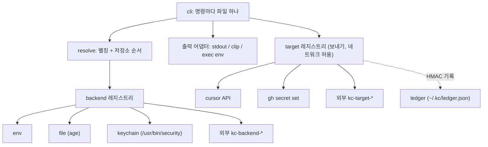

# 아키텍처



## 확장 지점

1. **Backend 인터페이스** — `Get/List/Set/Delete` + `Capabilities{CanWrite, CanList, Interactive, NeedsNetwork, Available}`. 각 종류가 `init()`에서 자체 등록(99designs/keyring 방식). 설정은 **이름 붙인 인스턴스**(Teller 방식).
2. **Resolver** — 별칭·순서를 config에서 읽음. 우선순위: 플래그 > `KC_*` 환경변수 > config.
3. **미들웨어** — `func(next Lookup) Lookup`. `config.middleware` 순서로 resolver 읽기 경로(`get`/`exec`/`cp`/`export`/`push`/`git-credential`/`status` 등)에 체인. 내장: `audit`(JSONL `~/.kc/audit.log`), `policy`(에이전트 allowlist). TTL 캐시·rate limit·출력 가림은 **DEFERRED**.
6. **Target 인터페이스** — 보내기 전용. `Push(ctx, []Secret) error`, `List(ctx) ([]Name, error)`, `Capabilities{NeedsNetwork, CanList}`. 저장소와 별도 레지스트리. 내장 `cursor`(net/http, 키는 키체인/`KC_CURSOR_API_KEY`), `gh`(`gh secret set -f -` 호출), 외부 `kc-target-<name>`(백엔드와 같은 JSON 규칙, config 명시 경로만).
7. **Ledger** — 보낸 기록 `{name, target, hmac, exported_at}`. HMAC 키는 암호화 파일 안에 있으므로 `kc status`는 파일 잠금 해제가 필요하다.
4. **출력 어댑터** — 클립보드: pbcopy / wl-copy·xclip(atotto) / OSC 52(자체 구현, tmux 패스스루).
5. **외부 확장** — 하위 명령 `kc-<name>`(git 방식, 내장 우선, 충돌 경고). 백엔드 `kc-backend-<name>`([플러그인 프로토콜 v1](plugin-protocol.md), stdin/stdout JSON). **config `[backend.*]` + `type = "external"`로만 실행**; PATH·`~/.kc/plugins`는 발견·`kc plugin list`용.

## 폴더 구조

```
cmd/kc/                 진입점, 오류→종료 코드 매핑
internal/cli/           명령
internal/resolve/       별칭·순서
internal/backend/       인터페이스, 레지스트리, 공통 적합성 테스트
internal/backend/env|file|keychain|external/
internal/middleware/    체인·policy·audit 래퍼
internal/target/        보내기 인터페이스, cursor|gh|external
internal/ledger/        보낸 기록·변경 비교
internal/clip/          클립보드 어댑터
internal/config/        ~/.config/kc/config.toml
```

## 설정 예시

```toml
order = ["link", "env", "store", "work"]

[backend.store]
type = "file"
path = "~/.kc/store.age"

[backend.work]
type = "keychain"
service_prefix = "local.study.ai"   # ai-core 항목 읽기 전용

[backend.link]
type = "link"

[link.myapp]
type = "keychain"
service = "other.app.service"
account = "default"

[backend.vault]
type = "external"
plugin = "1password"
timeout = "15s"

[alias]
github = ["gh", "GITHUB_TOKEN", "GH_TOKEN"]
```
